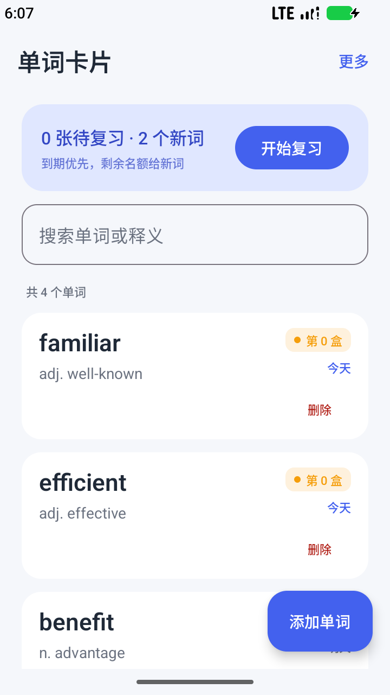
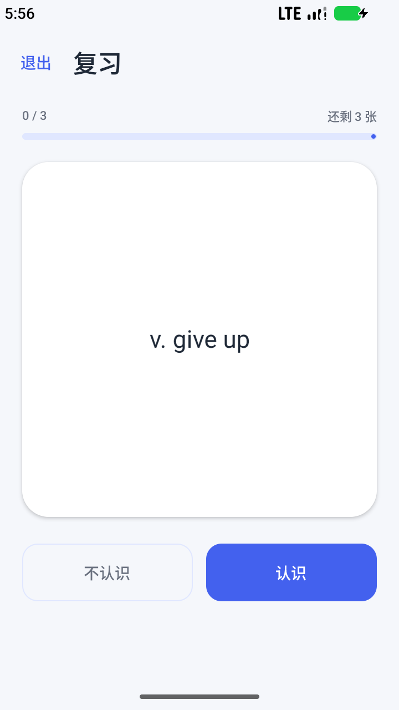
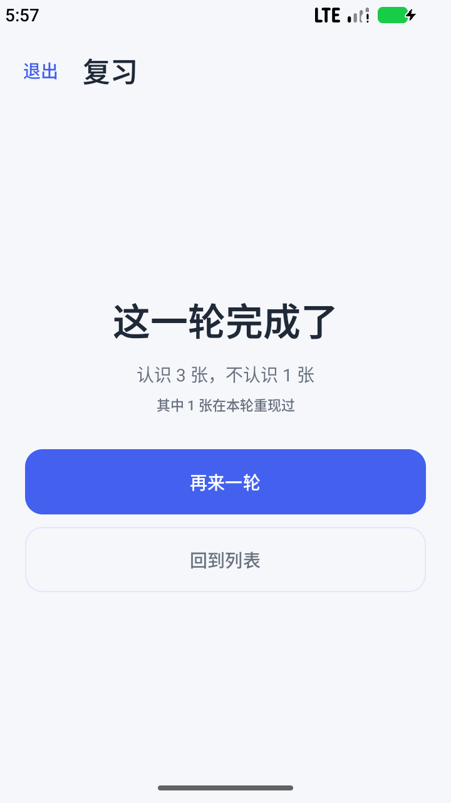
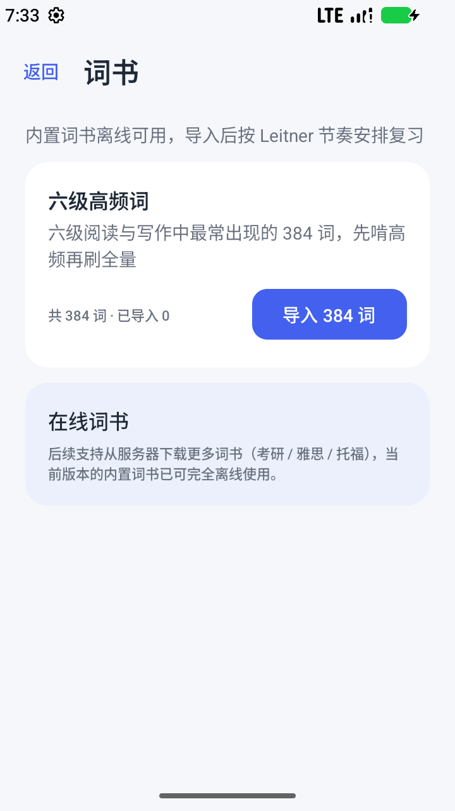
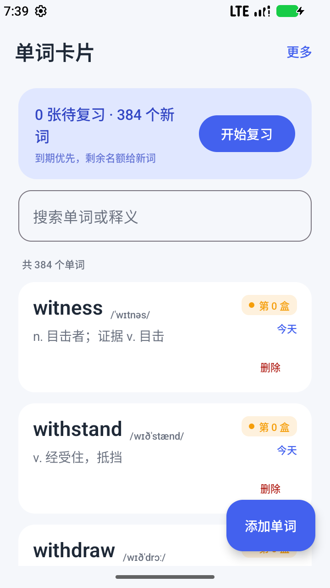
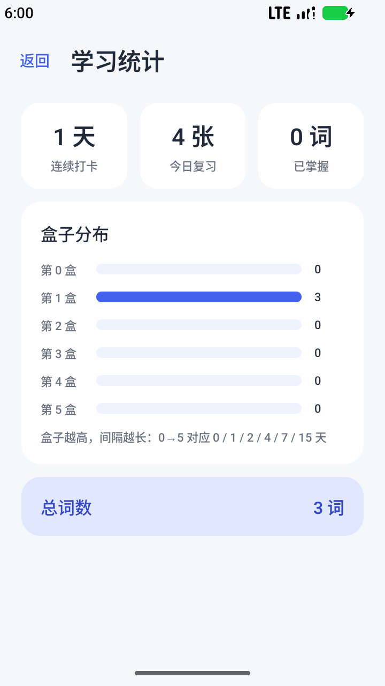
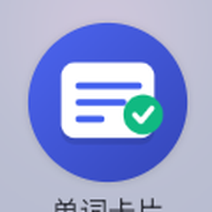
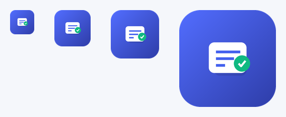

# 单词卡片 WordCards


离线优先的背单词 Android App —— 课程设计 / 简历项目。  
Kotlin + Jetpack Compose + Room + MVVM，**不需要后端、不需要登录，装上就能背**。

## 界面

<table>  
  <tr>  
    <td align="center">  
列表</td>  
    <td align="center">  
复习（翻面）</td>  
    <td align="center">  
完成页</td>  
  </tr>  
  <tr>  
    <td align="center">  
内置词书</td>  
    <td align="center">  
导入 384 词后</td>  
    <td align="center">  
统计</td>  
  </tr>  
</table>

## 功能

**开箱即用的词库**

- 内置**六级高频词 384 个**（含音标与释义），词书页一键导入，重复导入不会产生重复词
- 也可以自己手动添加单词，两种来源进入同一个复习队列
- 词库以 JSON 资产随 APK 发布，完全离线；新增词书只要往 `assets/wordbooks/` 丢同格式文件

**桌面图标**

 

- 自适应图标（API 26+）+ 5 个密度 PNG 兜底（API 24–25）+ Android 13 主题图标（Monochrome）
- 设计：蓝色渐变底 + 白色单词卡 + 绿色对勾；由 `tools/make_launcher_icons.py` 生成，改色改尺寸可复现
- 已在模拟器应用抽屉中实测（左图为启动器实际渲染效果）

**核心闭环**

- 单词增删改查：字段级校验、忽略大小写查重、删除二次确认（含复习流水级联删除）
- 列表：盒子徽标 + 「今天 / 明天 / N 天后 / 逾期 N 天」
- 复习：正面单词 → 点击翻面看释义（Y 轴翻转动画）→ 认识 / 不认识
- **Leitner 盒子算法**：box 0~5，间隔 0/1/2/4/7/15 天；认识进一格，不认识归零
- 到期队列：到期词优先，剩余名额给新词，受会话长度与每日新词上限双重约束
- 本地持久化：Room，杀进程不丢进度

**进阶功能（已实现）**

- 搜索（DAO 层模糊匹配，`flatMapLatest` 自动取消旧查询）
- 学习统计（连续打卡、今日复习、盒子分布、已掌握）
- 每日新词上限 / 每轮卡片数（DataStore 持久化）
- 每日提醒（WorkManager + 通知渠道 + Android 13 权限流）
- 导入导出 JSON（SAF 选文件，无需存储权限）

**明确不做**：登录注册、云同步、社交/排行榜、支付、后端。

## 技术栈

| 项   | 选型                                                                  |
| --- | ------------------------------------------------------------------- |
| 语言  | Kotlin 2.2.10（AGP 9 内置 Kotlin）                                      |
| UI  | Jetpack Compose + Material 3（BOM 2026.09.00）                        |
| 架构  | MVVM + Repository + 单向数据流                                           |
| 数据库 | Room 2.8.5（KSP 2.2.10-2.0.2，schema 已导出）                             |
| 导航  | Navigation Compose 2.10.2                                           |
| 异步  | Coroutines + Flow / StateFlow                                       |
| 设置  | DataStore Preferences 1.3.0                                         |
| 提醒  | WorkManager 2.12.0                                                  |
| DI  | 手写 `AppContainer` + `AppViewModelProvider`（不引入 Hilt）                |
| SDK | minSdk 24 / targetSdk 35 / compileSdk 37，开启 core library desugaring |

设计决策、模块划分、类签名、踩坑记录见 **[docs/ARCHITECTURE.md](docs/ARCHITECTURE.md)**。

## 如何运行

```bash
./gradlew :app:assembleDebug        # 编译
./gradlew :app:testDebugUnitTest    # 35 个 JVM 单元测试
./gradlew :app:connectedDebugAndroidTest  # 42 个 instrumented 测试（需设备/模拟器）
./gradlew :app:installDebug         # 安装到已连接设备
```

或用 Android Studio 打开本目录，Sync 后直接运行 `app`。推荐 JDK 17+。

## 验证结果

```
# JVM 单测（35 个）
LeitnerSchedulerTest    tests=13 failures=0
StudyQueueBuilderTest   tests=11 failures=0
StreakCalculatorTest    tests=11 failures=0

# instrumented 测试（42 个，真实 Room + SQLite）
WordDaoTest                    tests=12 failures=0
DefaultWordRepositoryTest      tests=13 failures=0
WordBackupCodecTest            tests=6  failures=0
WordBookCatalogTest            tests=5  failures=0
WordBookServiceTest            tests=6  failures=0
```

instrumented 用例覆盖的是「只能在设备上验证」的部分：`COLLATE NOCASE` 唯一索引、  
到期队列排序与 limit、外键级联删除、`withTransaction` 事务、新词额度扣减、备份编解码往返、  
词书资产完整性（无重复/无空字段）与导入幂等。

在 API 37 模拟器（720×1280）上手工走通：**导入六级词书（384 词）** → 新增 → 复习（含答错重现）→ 统计 → 删除 → 开启提醒，  
并导出数据库核对：3 个词复习后 `box` 全部 0→1、`nextReview` 指向次日、  
`review_logs` 4 条流水的 `boxBefore/boxAfter` 与算法一致。

桌面图标已打进 APK 并在模拟器抽屉中实测：`aapt2 dump badging` 显示 `application-icon` 指向  
`res/mipmap-anydpi-v26/ic_launcher.xml`，启动器渲染为「蓝底 + 白卡 + 绿勾」（`docs/screenshots/17-app-icon-drawer.png`）。

> 换包名后如果看到两个图标，是旧包 `com.example.wordbook` 还装着，`adb uninstall com.example.wordbook` 即可。

## 目录结构

```text
app/src/main/java/com/example/wordcards/
├── MainActivity.kt / WordCardsApplication.kt
├── domain/    纯 Kotlin：LeitnerScheduler、StudyQueueBuilder、StreakCalculator
├── data/      Room 实体与 DAO、Repository、DataStore、备份、词书、提醒门面
├── ui/        list / addedit / study / stats / settings / wordbook + navigation + theme
├── di/        AppContainer
├── worker/    ReminderWorker + ReminderScheduler
└── util/      DateProvider
app/src/main/res/
├── drawable/  ic_launcher_foreground / background / monochrome（矢量）
└── mipmap-*/  ic_launcher(.round).png（48~192px）+ mipmap-anydpi-v26 自适应图标
app/src/test/  3 个测试类，35 个用例（纯 JVM）
app/src/androidTest/  5 个测试类，42 个用例（Room / 事务 / 编解码 / 词书）
app/src/main/assets/wordbooks/  内置词书 JSON（六级高频 384 词）
app/schemas/   Room 导出 schema
tools/         make_launcher_icons.py（图标生成脚本）
docs/          架构文档 + 截图
```

## 三个环境坑（已处理，换电脑时注意）

1. **AGP 9 内置 Kotlin**：不要再应用 `org.jetbrains.kotlin.android`，否则直接构建失败。
2. **KSP 与内置 Kotlin**：`gradle.properties` 保留 `android.disallowKotlinSourceSets=false`。
3. **JDK 25**：会打印 `Kotlin ... falling back to JVM_24`，无害，字节码目标仍是 17。

## 后续可做

API 24 真机回归、API 24~25 上 PNG 兜底图标的实拍确认、导入导出的 SAF 点击端到端验证、在线词书下载、更多词书（四级/考研/雅思）、标签分组（`Word.deckId` 已预留）、Hilt 迁移、Compose UI 测试。
