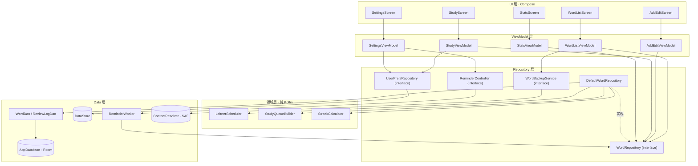
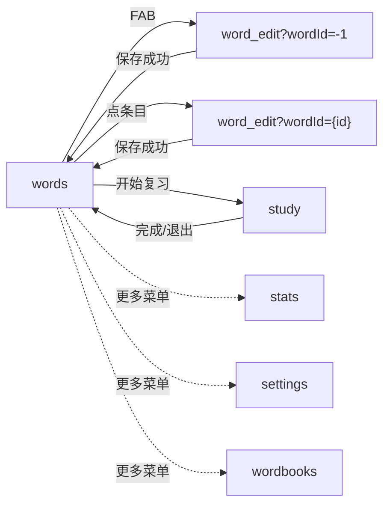

# WordCards 架构设计与实现说明

> 版本 v2.0 ｜ 状态：**MVP + 5 项进阶功能已实现并通过验证**  
> 本文既是架构文档，也是答辩材料。设计决策给出理由，实现结果给出证据。

---

## 1. 项目定位与目标

| 层次 | 目标      | 达成情况                      |
| -- | ------- | ------------------------- |
| 产品 | 自己愿意每天用 | 5 个页面闭环：列表 → 复习 → 统计 → 设置 |
| 工程 | 架构站得住   | 分层单向依赖，核心算法可单测（35 JVM + 31 instrumented） |

---

## 2. 功能范围

### 2.1 MVP（全部完成）

| #  | 功能           | 状态 | 说明                                      |
| -- | ------------ | -- | --------------------------------------- |
| F1 | 单词增删改查       | ✅  | 含字段级校验、忽略大小写查重、删除二次确认                   |
| F2 | 列表展示         | ✅  | 按创建时间倒序，显示盒子与「今天/明天/N 天后/逾期 N 天」        |
| F3 | 复习模式         | ✅  | 正面单词，点击翻面看释义，带 Y 轴翻转动画                  |
| F4 | 认识 / 不认识     | ✅  | 未翻面时按钮禁用，防误触                            |
| F5 | Leitner 盒子算法 | ✅  | box 0~5，间隔 0/1/2/4/7/15 天，纯函数实现         |
| F6 | 到期队列         | ✅  | 到期词优先 + 新词配额，会话长度上限                     |
| F7 | 本地持久化        | ✅  | Room，进程重启不丢；schema 已导出                  |
| F8 | 手动 DI        | ✅  | `AppContainer` + `AppViewModelProvider` |
| F9 | 内置词书        | ✅  | 六级高频 384 词，一键导入且幂等（详见 §7.3）           |

### 2.2 进阶（已实现 5 项 + 导入导出）

| 优先级 | 功能        | 状态   | 实现要点                                    |
| --- | --------- | ---- | --------------------------------------- |
| P1  | 搜索        | ✅    | DAO 层 `LIKE` + `flatMapLatest` 自动取消旧查询  |
| P2  | 学习统计      | ✅    | `ReviewLog` 聚合，连续打卡纯函数计算                |
| P3  | 卡片翻转动画    | ✅    | `rotationY` + `cameraDistance` + 双面绘制   |
| P4  | 每日新词上限    | ✅    | 需 `firstReviewedEpochDay` 字段支撑「今日已引入」计数 |
| P5  | 每日提醒      | ✅    | WorkManager 周期任务 + 通知渠道 + 权限流           |
| P6  | 导入导出 JSON | ✅    | SAF 选文件（无需存储权限）+ `org.json` 编解码         |
| P7  | 内置词书（六级高频 384 词） | ✅    | assets 内置 JSON，一键导入，幂等；标签与在线下载仍未做 |
| P8  | 单元测试      | ✅    | 35 个 JVM + 42 个 instrumented（DAO / 事务 / 编解码 / 词书） |
| P9  | Hilt      | ⬜ 未做 | 迁移路径见 §11.8                             |
| P10 | 词典 API    | ⬜ 未做 | MVP 坚持离线                                |

---

## 3. 技术选型表

| 技术                        | 用途          | MVP 必需 | 实际版本           | 选型理由                                |
| ------------------------- | ----------- | ------ | -------------- | ----------------------------------- |
| Kotlin                    | 主语言         | ✅      | 2.2.10（AGP 内置） | 协程 + 空安全 + Compose 事实标准             |
| Jetpack Compose           | 全部 UI       | ✅      | BOM 2026.09.00 | 声明式，状态驱动，开发量远低于 View                |
| Material 3                | 设计系统        | ✅      | 随 BOM          | 主题/组件齐全，暗色开箱可用                      |
| Navigation Compose        | 路由          | ✅      | 2.10.2         | 与 Compose 同一套状态模型，无 Fragment        |
| MVVM + Repository + UDF   | 架构          | ✅      | —              | 单向数据流让「状态从哪来」唯一                     |
| Room                      | 本地库         | ✅      | 2.8.5          | 编译期 SQL 校验 + 原生 Flow                |
| Coroutines / Flow         | 异步          | ✅      | stdlib         | `StateFlow` 天然去重，配合生命周期收集           |
| DataStore                 | 设置          | ✅      | 1.3.0          | 有事务、有 Flow，替代已废弃的 SharedPreferences |
| ViewModel                 | 状态持有        | ✅      | 2.11.0         | 配置变更不丢状态                            |
| WorkManager               | 每日提醒        | 进阶     | 2.12.0         | 有约束、可持久化，比裸 Service 稳               |
| core library desugaring   | `java.time` | ✅      | 2.1.5          | minSdk 24 没有原生 `java.time`          |
| KSP                       | Room 注解处理   | ✅      | 2.2.10-2.0.2   | kapt 已不推荐；版本必须与 Kotlin 对齐           |
| JUnit4                    | 单元测试        | 进阶     | 4.13.2         | 算法与纯函数测试                            |
| Hilt / Retrofit / Paging3 | —           | ❌      | —              | 本项目规模下属于过度设计                        |

---

## 4. 整体架构



**数据流（单向，不允许反向）**

```
用户事件 → ViewModel 事件函数 → Repository → DAO → SQLite
                ↑                                  │
                └──── StateFlow ← Flow ←───────────┘
```

**三条硬边界**

1. `ui/` 不 import `androidx.room.*`
2. `data/`、`domain/` 不 import `androidx.compose.*`
3. `domain/` 不 import `data.local.entity.*`（`StudyQueueBuilder` 用泛型实现，正是为此）

---

## 5. 分层职责

| 层          | 职责                                  | 不做什么                        | 实际落点                                                      |
| ---------- | ----------------------------------- | --------------------------- | --------------------------------------------------------- |
| UI         | 渲染 + 收集事件 + 发起系统交互（SAF、权限、Snackbar） | 不写 SQL、不算业务                 | `ui/list`、`ui/study`…                                     |
| ViewModel  | 状态拥有者、用例编排                          | 不持 Context、不 import Compose | `*ViewModel.kt`                                           |
| Domain     | 纯业务规则                               | 不依赖 Android / 数据库           | `LeitnerScheduler`、`StudyQueueBuilder`、`StreakCalculator` |
| Repository | 唯一数据入口、事务边界、输入校验                    | 不感知 UI                      | `DefaultWordRepository`                                   |
| Data       | 建表、SQL、Flow、文件 IO                   | 不含业务判断                      | `WordDao`、`AppDatabase`、`BackupService`                   |

**关于要不要 UseCase 层**：标准 Clean 会为每个操作加一个 UseCase。本项目多数 UseCase 只有一行转发，属于纯样板。做法是**只把有真实逻辑的部分抽成领域类**（三个），其余 Repository 直连 ViewModel。答辩时这正好能讲清「为什么不做过度设计」。

---

## 6. 模块划分

**结论：单 Gradle 模块 + data/domain 按 layer 分包 + ui 内部按 feature 分包。**

```
:app
└── com.example.wordcards
     ├── data/{local, prefs, repository, backup, reminder}   ← 按 layer
     ├── domain/{model, review, stats}                       ← 按 layer
     ├── ui/{list, addedit, study, stats, settings, navigation, theme, components} ← 按 feature
     ├── di/  worker/  util/
```

| 为什么不是纯 feature-first                                | 为什么现在不拆多 module                                                  |
| --------------------------------------------------- | ---------------------------------------------------------------- |
| 纯 feature-first 只在多 module 下成立；单模块硬拆会出现两份 `WordDao` | 拆模块需要 `build-logic` 约定插件、`api/implementation` 边界，一半时间花在 Gradle 上 |
| UI 变化频率最高、边界最清晰，所以只在 ui 内按 feature 分                | 包结构已按「data 不依赖 ui」组织，未来搬迁只需移动目录 + 加 build 文件                     |

---

## 7. 数据模型

### 7.1 `Word`

| 字段                      | 类型      | 默认   | 说明                           |
| ----------------------- | ------- | ---- | ---------------------------- |
| `id`                    | Long    | 0    | 主键，autoGenerate              |
| `word`                  | String  | —    | **COLLATE NOCASE**，唯一索引忽略大小写 |
| `definition`            | String  | —    | 释义                           |
| `phonetic`              | String? | null | 音标                           |
| `example`               | String? | null | 例句                           |
| `box`                   | Int     | 0    | Leitner 盒子 0~5               |
| `nextReviewEpochDay`    | Long    | 0    | 下次复习日（epochDay）              |
| `correctCount`          | Int     | 0    | 认识次数                         |
| `wrongCount`            | Int     | 0    | 不认识次数                        |
| `createdAt`             | Long    | now  | 创建毫秒（排序/展示）                  |
| `updatedAt`             | Long    | now  | 更新毫秒                         |
| `lastReviewedEpochDay`  | Long?   | null | 上次复习日                        |
| `firstReviewedEpochDay` | Long?   | null | **首次复习日**，null = 仍是新词        |
| `deckId`                | Long?   | null | 词书外键占位，未启用                   |

**索引**

| 索引                          | 类型     | 服务于                                                   |
| --------------------------- | ------ | ----------------------------------------------------- |
| `word`                      | UNIQUE | 查重（NOCASE 生效）                                         |
| `(nextReviewEpochDay, box)` | 普通     | 到期队列 `WHERE nextReview <= ? ORDER BY nextReview, box` |
| `(box)`                     | 普通     | 统计页 `GROUP BY box`                                    |
| `(firstReviewedEpochDay)`   | 普通     | 今日新词计数 / 新词队列                                         |

**三个关键决策**

1. **存 `epochDay` 不存时间戳**：Leitner 语义是「哪一天复习」，整数比较不受时区/夏令时影响，也能走索引。代价是精度只到天——正好匹配算法。
2. **新增 `firstReviewedEpochDay`（设计 v1 没有）**：`correctCount + wrongCount == 0` 能判断「是不是新词」，但答不出「今天已经引入了几个新词」。每日新词上限需要按天统计，事后推导既慢又不准，所以显式存一列。
3. **不用 `TypeConverter`**：MVP 全程基础类型（Long/Int/String?/Boolean），少一层转换就少一类 `Cannot figure out how to save this field` 的编译错误。

### 7.2 `ReviewLog`

| 字段                       | 类型      | 说明                                      |
| ------------------------ | ------- | --------------------------------------- |
| `id`                     | Long    | 主键                                      |
| `wordId`                 | Long    | FK → words.id，**CASCADE**               |
| `reviewedAtEpochDay`     | Long    | 按日聚合                                    |
| `reviewedAtMillis`       | Long    | 精确时间戳                                   |
| `known`                  | Boolean | true=认识（用 Boolean 而非枚举，免 TypeConverter） |
| `boxBefore` / `boxAfter` | Int     | 便于复盘算法效果                                |

索引：`(reviewedAtEpochDay)`、`(wordId)`。

> 为什么 MVP 就要这张表：`Word` 上的计数只能回答「一共答对几次」，答不了「今天复习了多少」「连续打卡几天」。等做统计再补表就要写 Room 迁移；现在多一条 insert 的成本几乎为零。

### 7.3 内置词书（资产，不入库）

词书不是一张表，而是 **APK 里的 JSON 资产** + **一次性导入动作**：

```
app/src/main/assets/wordbooks/cet6_high_freq.json
{
  "id": "cet6_high_freq",
  "name": "六级高频词",
  "description": "六级阅读与写作中最常出现的 384 词…",
  "version": 1,
  "words": [ { "word": "abandon", "phonetic": "/əˈbændən/", "definition": "v. 放弃；抛弃；遗弃" } ]
}
```

**为什么不做 `Deck` 表 + 外键**
- 用户要的是「把这些词变成我的词」，导入后它就和手动添加的词完全一样（同样进复习队列、同样算统计）。多一张表就多一次 join、多一套级联规则，收益只有「能整本删除」，而按前缀筛删并不难。
- `Word.deckId` 字段保留着，将来真要「按词书分组统计」再加上即可。

**为什么导入是幂等的**
`DefaultWordBookService.importPack` 直接复用 `WordRepository.importWords`，遇到已存在的词（NOCASE 比对）计为「跳过」。用户连点两次导入不会把库撑成两倍——这一条有 instrumented 测试守着。

**「已导入 N 词」怎么算**
用**单词名求交集**，不是「词书总词数 − 库里总数」。用户可能先手动加过 `abandon`，数量差会算错，交集不会。

**在线下载的接入点**
`WordBookCatalog.loadAll()` 目前扫 `AssetManager`。要做在线词书，只需把它换成「先读本地缓存目录 + 再扫 assets」，下载完写个同格式 JSON 即可，`WordBookService` 与 UI 一行不用改。

---

## 8. 复习算法

### 8.1 盒子与间隔

| box | 含义       | 认识后   | 间隔         |
| --- | -------- | ----- | ---------- |
| 0   | 新词 / 刚遗忘 | 1     | 0 天（当天仍到期） |
| 1   | 初见       | 2     | 1 天        |
| 2   | 眼熟       | 3     | 2 天        |
| 3   | 记得       | 4     | 4 天        |
| 4   | 较熟       | 5     | 7 天        |
| 5   | 掌握       | 5（封顶） | 15 天       |

区间表 `intArrayOf(0, 1, 2, 4, 7, 15)` 可注入（构造参数），但 MVP 不做成设置项——固定值让单测有确定预期。

### 8.2 状态更新

| 操作  | box             | nextReview                 | 计数               |
| --- | --------------- | -------------------------- | ---------------- |
| 认识  | `min(box+1, 5)` | `today + interval[newBox]` | correctCount + 1 |
| 不认识 | **0（归零，不是减一）**  | `today`                    | wrongCount + 1   |

两者都更新 `lastReviewedEpochDay = today`、`firstReviewedEpochDay = 原值 ?: today`、`updatedAt`，并写一条 `ReviewLog`——**全部在一个 `withTransaction` 里**。

**为什么归零而非减一**：减一需要额外处理下界，多一个分支就多一处可能出错的边界；语义上「遗忘即记忆强度不可信」，归零更符合直觉。

### 8.3 到期队列

```sql
-- 复习词
SELECT * FROM words
WHERE firstReviewedEpochDay IS NOT NULL AND nextReviewEpochDay <= :today
ORDER BY nextReviewEpochDay ASC, box ASC, id ASC
LIMIT :limit

-- 新词
SELECT * FROM words WHERE firstReviewedEpochDay IS NULL
ORDER BY createdAt ASC, id ASC LIMIT :limit
```

排序理由：逾期最久优先还账；同天到期按 box 升序（低盒更脆弱）；`id` 兜底保证顺序稳定可复现。

**新词必须单独查**：新词的 `nextReview` 是「创建日」，天然满足 `<= today`。如果只用一条 SQL，第一次复习就会把全部新词一次性抽出来。

### 8.4 队列组装（`StudyQueueBuilder`）

```
reviews  = due.take(sessionSize)
剩余名额  = sessionSize - reviews.size
新词额度  = dailyNewWordLimit - introducedToday   （不足 0 则视为 0）
实际新词  = min(剩余名额, 新词额度, 候选数)
返回      = reviews + 新词
```

这三条规则的顺序不能反：到期优先 → 剩余名额 → 每日新词额度。

**一个容易忽略的语义**：`introducedToday` 统计的是 `firstReviewedEpochDay = today` 的词，
也就是「今天第一次被复习」的词——不管它是今天新建的还是上周建的。
换句话说，**今天首次复习任何词都会占用当天的新词额度**。这是刻意的：额度的目的是限制
「每天新增多少记忆负担」，而不是限制「每天新建多少条记录」。写 instrumented 测试时这一点
会直接决定用例怎么造数据（见 `DefaultWordRepositoryTest.今天首次复习的词会占用当日新词额度`）。

### 8.5 会话内的「错词重现」

- **DB 侧**：答错 → `nextReview = today`，所以退出应用再进来仍然到期，跨会话不丢。
- **内存侧**：答错的卡 requeue 到队尾，让本轮体验连贯。
- **上限**：每词每轮最多重现 **2 次**（`MAX_REQUEUE_PER_WORD`）。不设上限的话，全错的用户会陷入死循环。

### 8.6 边界处理

| 场景          | 处理                                       |
| ----------- | ---------------------------------------- |
| 会话中途跨零点     | 会话开始时取一次 `today` 并**冻结**整轮，否则会出现「越答到期越少」 |
| box 越界（脏数据） | `coerceIn(0, 5)` 双重保护，算法自愈不抛异常           |
| 空队列         | `phase = EMPTY`，显示空态，不出现空白卡片             |
| 词在复习中被删除    | `submitReview` 返回 null，不 requeue，直接跳下一张  |
| 改系统时间/时区    | 可能提前或延后一天到期，判定为可接受（不引入服务端时间）             |

---

## 9. 页面与导航

### 9.1 路由

| 路由                          | 页面                   | 参数                 |
| --------------------------- | -------------------- | ------------------ |
| `words`                     | 列表（startDestination） | —                  |
| `word_edit?wordId={wordId}` | 新增 / 编辑（复用）          | `wordId = -1` 表示新增 |
| `study`                     | 复习                   | —                  |
| `stats`                     | 统计                   | —                  |
| `settings`                  | 设置                   | —                  |
| `wordbooks`                 | 词书（内置词书导入）          | —                  |

所有跳转带 `launchSingleTop = true`，连点不会压两层。



### 9.2 每页的输入 / 输出 / 状态 / 事件

| 页面 | 输入          | 输出                    | 关键状态                                                                                              | 关键事件                                                                                                             |
| -- | ----------- | --------------------- | ------------------------------------------------------------------------------------------------- | ---------------------------------------------------------------------------------------------------------------- |
| 列表 | 搜索词、点击      | 跳编辑/复习/统计/设置、Snackbar | `words`、`query`、`dueCount`、`newWordCount`、`pendingDelete`、`message`、`isBusy`                      | `onQueryChange`、`onDeleteClick/Confirm/Dismiss`、`onExport(uri)`、`onImport(uri)`                                  |
| 编辑 | `wordId`、表单 | 保存成功 `popBackStack`   | `word`、`definition`、`phonetic`、`example`、`wordError`、`isSaving`、`saved`、`notFound`                | `onXxxChange`、`onSave`、`onSavedHandled`                                                                          |
| 复习 | 无           | 完成/退出回列表              | `phase`、`card`、`isFlipped`、`totalCount`、`remaining`、`answeredCount`、`known/unknown/requeuedCount` | `startSession`、`onFlip`、`onAnswer(result)`、`restartSession`                                                      |
| 统计 | 无           | —                     | `StudyStats`（直接复用领域模型）                                                                            | —                                                                                                                |
| 设置 | 无           | 权限申请、Snackbar         | `prefs`、`awaitingPermission`、`message`                                                            | `onSessionSizeChange`、`onDailyNewWordLimitChange`、`onReminderToggle`、`onPermissionResult`、`onReminderTimeChange` |
| 词书 | 无           | Snackbar                | `books`、`importingId`、`message`                                                                   | `reload`、`onImport(packId)`                                                                                       |


复习页用 `phase: StudyPhase{LOADING, EMPTY, STUDYING, FINISHED}` 而不是 4 个布尔——`2^4` 种组合里大半非法。

---

## 10. 状态管理

### 10.1 三条规则

1. 每页一个 `UiState` + 一个 `StateFlow<UiState>`（统计页例外：只读，直接用 `StudyStats`）。
2. `UiState` 全 `val` + `copy()`，暴露 `asStateFlow()`，不暴露可变状态。
3. 一次性事件用 `UiMessage`（sealed interface）承载**语义**，文案在 UI 层用 `stringResource` 翻译——ViewModel 里不出现中文字面量。

### 10.2 组合方式

```kotlin
// 列表页：搜索词 flatMapLatest 查库，再与到期数/新词数/本地交互态组合
combine(
    query.flatMapLatest { repository.observeWords(it) },
    repository.observeDueCount(today),
    repository.observeNewWordCount(),
    query,
    local
) { ... }.stateIn(viewModelScope, SharingStarted.WhileSubscribed(5_000), WordListUiState())
```

`flatMapLatest` 的意义：搜索词一变，旧查询自动取消，不会出现「先输 a 后输 ab，结果却是 a 的」这种乱序。

### 10.3 复习页的会话模型

```kotlin
private val queue = ArrayDeque<Word>()      // 剩余队列
private val answeredIds = mutableSetOf<Long>()  // 进度分子（去重）
private val requeueCount = mutableMapOf<Long, Int>()
private var working: Word? = null           // 当前卡
```

进度条分母是「本轮初始卡数」，分子是「答过的去重卡数」；「还剩 N 张」用队列长度。两个指标分开，requeue 时进度条不会倒退。

---

## 11. 关键类与签名

> 以下签名与仓库代码一致（省略实现）。

### 11.1 实体与 DAO

```kotlin
@Entity(tableName = "words", indices = [Index("word", unique = true), Index("nextReviewEpochDay","box"), Index("box"), Index("firstReviewedEpochDay")])
data class Word(
    @PrimaryKey(autoGenerate = true) val id: Long = 0L,
    @ColumnInfo(collate = ColumnInfo.NOCASE) val word: String,
    val definition: String,
    val phonetic: String? = null,
    val example: String? = null,
    val box: Int = 0,
    val nextReviewEpochDay: Long = 0L,
    val correctCount: Int = 0,
    val wrongCount: Int = 0,
    val createdAt: Long = System.currentTimeMillis(),
    val updatedAt: Long = System.currentTimeMillis(),
    val lastReviewedEpochDay: Long? = null,
    val firstReviewedEpochDay: Long? = null,
    val deckId: Long? = null
)

@Dao interface WordDao {
    fun observeWords(query: String): Flow<List<Word>>
    suspend fun getDueWords(today: Long, limit: Int): List<Word>
    suspend fun getNewWords(limit: Int): List<Word>
    fun observeDueCount(today: Long): Flow<Int>
    fun observeNewWordCount(): Flow<Int>
    suspend fun countIntroducedOn(today: Long): Int
    suspend fun getById(id: Long): Word?
    fun observeById(id: Long): Flow<Word?>
    suspend fun getAll(): List<Word>
    fun observeTotalCount(): Flow<Int>
    fun observeBoxDistribution(): Flow<List<BoxCount>>
    fun observeCountWithMinBox(minBox: Int): Flow<Int>
    @Insert(onConflict = OnConflictStrategy.IGNORE) suspend fun insert(word: Word): Long
    @Insert(onConflict = OnConflictStrategy.IGNORE) suspend fun insertAll(words: List<Word>): List<Long>
    @Update suspend fun update(word: Word)
    suspend fun deleteById(id: Long)
    suspend fun countByWord(word: String, excludeId: Long): Int
}
```

### 11.2 领域层

```kotlin
interface ReviewScheduler {
    fun schedule(currentBox: Int, result: ReviewResult, today: Long): ReviewOutcome
    fun intervalDaysFor(box: Int): Int
    companion object { const val MAX_BOX = 5 }
}

data class ReviewOutcome(val box: Int, val nextReviewEpochDay: Long, val intervalDays: Int)

class LeitnerScheduler(private val intervals: IntArray = DEFAULT_INTERVALS.copyOf()) : ReviewScheduler {
    companion object { val DEFAULT_INTERVALS = intArrayOf(0, 1, 2, 4, 7, 15) }
}

object StudyQueueBuilder {
    fun <T> assemble(dueWords: List<T>, newWordCandidates: List<T>,
                     sessionSize: Int, introducedToday: Int, dailyNewWordLimit: Int): List<T>
}

object StreakCalculator { fun streak(activeDaysDesc: List<Long>, today: Long): Int }
```

### 11.3 Repository

```kotlin
interface WordRepository {
    fun observeWords(query: String): Flow<List<Word>>
    fun observeWord(id: Long): Flow<Word?>
    fun observeDueCount(today: Long): Flow<Int>
    fun observeNewWordCount(): Flow<Int>
    fun observeStats(today: Long): Flow<StudyStats>
    suspend fun getWord(id: Long): Word?
    suspend fun addWord(draft: WordDraft, today: Long): SaveResult
    suspend fun updateWord(id: Long, draft: WordDraft, today: Long): SaveResult
    suspend fun deleteWord(id: Long)
    suspend fun loadStudyQueue(today: Long, sessionSize: Int, dailyNewWordLimit: Int): List<Word>
    suspend fun submitReview(wordId: Long, result: ReviewResult, today: Long,
                             nowMillis: Long = System.currentTimeMillis()): Word?
    suspend fun exportAll(): List<Word>
    suspend fun importWords(drafts: List<WordDraft>, today: Long): ImportSummary
}

sealed interface SaveResult {
    data class Success(val id: Long) : SaveResult
    data object DuplicateWord : SaveResult
    data class Invalid(val field: DraftField) : SaveResult
    data object NotFound : SaveResult
}
```

`submitReview` 的事务体：

```kotlin
database.withTransaction {
    val current = wordDao.getById(wordId) ?: return@withTransaction null
    val outcome = scheduler.schedule(current.box, result, today)
    wordDao.update(current.copy(box = outcome.box, nextReviewEpochDay = outcome.nextReviewEpochDay, /* 计数/日期 */))
    reviewLogDao.insert(ReviewLog(/* boxBefore/boxAfter/known */))
    updated
}
```

### 11.4 备份与提醒（接口隔离平台能力）

```kotlin
interface WordBackupService {
    suspend fun exportTo(uri: Uri): Int
    suspend fun importFrom(uri: Uri): ImportSummary
}

interface ReminderController {
    fun apply(enabled: Boolean, hour: Int, minute: Int)
    fun hasNotificationPermission(): Boolean
}
```

> ViewModel 不该持 Context。这两个接口把「文件读写」和「系统调度」挡在数据层，ViewModel 只接收 `Uri` 值对象与布尔结果。

### 11.5 依赖装配

```kotlin
interface AppContainer {
    val database: AppDatabase
    val scheduler: ReviewScheduler
    val clock: Clock
    val wordRepository: WordRepository
    val prefsRepository: UserPrefsRepository
    val backupService: WordBackupService
    val reminderController: ReminderController
}

class DefaultAppContainer(context: Context) : AppContainer { /* 全部 by lazy */ }

object AppViewModelProvider {
    val Factory = viewModelFactory {
        initializer { WordListViewModel(container().wordRepository, container().backupService, container().clock) }
        initializer { AddEditViewModel(container().wordRepository, container().clock, createSavedStateHandle()) }
        // Study / Stats / Settings 同理
    }
}
```

**Hilt 迁移路径**：`AppContainer` 的 7 个属性 → 7 个 `@Provides`；`DefaultAppContainer` → `@Module @InstallIn(SingletonComponent::class)`；`AppViewModelProvider` → 5 个 `@HiltViewModel` + `hiltViewModel()`。因为 Repository 早已是 interface，迁移只动装配层。

---

## 12. 目录结构（实际）

```
app/src/main/java/com/example/wordcards/
├── WordCardsApplication.kt          # 建容器 + 建通知渠道
├── MainActivity.kt                  # 单 Activity + enableEdgeToEdge
├── di/
│   ├── AppContainer.kt
│   └── (AppViewModelProvider 在 ui/ 下，因为它依赖 ViewModel 类型)
├── domain/
│   ├── model/  ReviewResult, ReviewOutcome, WordDraft, SaveResult, StudyStats
│   ├── review/ ReviewScheduler, LeitnerScheduler, StudyQueueBuilder
│   └── stats/  StreakCalculator
├── data/
│   ├── local/  AppDatabase, entity/{Word,ReviewLog}, dao/{WordDao,ReviewLogDao}
│   ├── prefs/  UserPrefs, DataStoreUserPrefsRepository
│   ├── repository/ WordRepository, DefaultWordRepository
│   ├── backup/ WordBackupService, WordBackupCodec
│   ├── wordbook/ WordBookPack, WordBookCatalog, WordBookService
│   └── reminder/ ReminderController
├── ui/
│   ├── WordCardsApp.kt              # 根容器 → NavHost
│   ├── AppViewModelProvider.kt
│   ├── UiMessage.kt
│   ├── navigation/ Routes, WordCardsNavHost
│   ├── theme/ Color, Type, Theme
│   ├── components/ CommonUi（EmptyState / ConfirmDialog / UiMessage.asText）
│   ├── list/   WordListScreen, WordListViewModel, WordListUiState
│   ├── addedit/ AddEditScreen, AddEditViewModel, AddEditUiState
│   ├── study/  StudyScreen, FlashCard, StudyViewModel, StudyUiState
│   ├── stats/  StatsScreen, StatsViewModel
│   ├── settings/ SettingsScreen, SettingsViewModel
│   └── wordbook/ WordBookScreen, WordBookViewModel
├── worker/ ReminderScheduler, ReminderWorker
└── util/   DateProvider

app/src/main/assets/wordbooks/      # 内置词书（JSON 资产，随 APK 发布）
└── cet6_high_freq.json             # 六级高频词 384 条

app/src/test/java/com/example/wordcards/          # JVM 单测：35 个
├── domain/review/LeitnerSchedulerTest.kt      # 13
├── domain/review/StudyQueueBuilderTest.kt     # 11
└── domain/stats/StreakCalculatorTest.kt       # 11

app/src/androidTest/java/com/example/wordcards/   # instrumented：42 个
├── data/local/WordDaoTest.kt                  # 12
├── data/repository/DefaultWordRepositoryTest.kt # 13
├── data/backup/WordBackupCodecTest.kt         # 6
├── data/wordbook/WordBookCatalogTest.kt       # 5
└── data/wordbook/WordBookServiceTest.kt       # 6

app/src/main/res/drawable/        # ic_launcher_{foreground,background,monochrome}.xml（矢量）
app/src/main/res/mipmap-*/        # ic_launcher(.round).png，48/72/96/144/192
app/src/main/res/mipmap-anydpi-v26/  # 自适应图标（background + foreground + monochrome）

app/schemas/…/1.json              # Room 导出的 schema（应提交进版本库）
docs/screenshots/                 # 真机截图（模拟器 720×1280）
tools/make_launcher_icons.py      # 图标生成脚本（PNG 各密度 + 512 预览）
```

### 12.1 图标资源

图标是「蓝色渐变底 + 白色单词卡 + 绿色对勾」，语义是「卡片 + 已掌握」，与本项目两个核心概念一致。

| 资源 | 用途 | 说明 |
|---|---|---|
| `mipmap-anydpi-v26/ic_launcher.xml` | API 26+ 自适应图标 | `background` / `foreground` / `monochrome` 三层 |
| `mipmap-{m,h,xh,xxh,xxxh}dpi/ic_launcher.png` | API 24–25 兜底 | 48/72/96/144/192，脚本生成 |
| `ic_launcher_round.png` | 圆形启动器 | 同上，圆形遮罩版本 |
| `drawable/ic_launcher_monochrome.xml` | Android 13 主题图标 | 只保留描边剪影，由系统整体着色 |

**两个容易踩的点**
1. 自适应图标的前景层是 108×108，但**只有中心约 66dp 的圆形区域保证可见**，所以图形必须收在中间，四周留白会被启动器裁掉。本项目图形收在 33~79 区间。
2. 前景层里没有 `elevation`，想要投影只能自己画一层半透明黑——这就是 `ic_launcher_foreground.xml` 里第一条 path 存在的原因。

`tools/make_launcher_icons.py` 与矢量层共用同一套 108 单位坐标（`UNIT=108`），
所以「矢量层」和「PNG 兜底」不会出现两套视觉。改主色时两处一起改。

**一个实际踩到的坑**：包名从 `com.example.wordbook` 改成 `wordcards` 后，旧包如果还装在设备上，
应用抽屉里会出现**两个图标**——旧的「单词打卡」顶着系统默认机器人图标，很容易让人误以为
「新版本没有图标」。这不是图标资源的问题，卸载旧包即可：
`adb uninstall com.example.wordbook`。

---

## 13. 开发里程碑

| 阶段 | 目标 | 产出 | 状态 |
|---|---|---|---|
| M0 脚手架 | 环境与依赖 | 包名迁移、版本目录、Compose 主题、Leitner 算法 + 13 单测 | ✅ |
| M1 数据层 | Room 能存能查 | 实体/DAO/DB/Repository/DataStore/AppContainer | ✅ |
| M2 列表 + 增删改 | CRUD 闭环 | 列表页、编辑页、NavHost、两个 ViewModel | ✅ |
| M3 复习核心 | 算法跑通 | 复习页、会话快照、事务提交 | ✅ |
| M4 打磨 | 能用不难受 | 空态、Snackbar、翻转动画、退出拦截、列表 key | ✅ |
| M5 进阶 | 拉开差距 | 搜索、统计、每日新词上限、每日提醒、导入导出 | ✅ |
| M6 交付 | 可答辩 | README、架构文档、截图、测试 | ✅ |

---

## 14. 验收标准与结果

### 14.1 功能验收（逐条实测）

| 项 | 结果 | 证据 |
|---|---|---|
| 新增后列表自动刷新 | ✅ | 新增 3 个词后角标与列表同步（Flow 驱动） |
| 重复单词被拦截 | ✅ | 唯一索引 + NOCASE，`insert` 返回 -1 转业务错误 |
| 删除二次确认 + 列表同步 | ✅ | 截图 `10-delete-confirm.png`、`11-after-delete.png` |
| 复习队列只含到期词 | ✅ | 学习 3 词后 `nextReview = tomorrow`，队列变空 |
| 翻面显示释义 | ✅ | `03-study-front.png` / `04-study-back.png` |
| 认识 → box+1、间隔前移 | ✅ | 数据库核对：3 词全部 box 0→1，nextReview = today+1 |
| 不认识 → box 归零、当天到期 | ✅ | `benefit` 先 UNKNOWN 后 KNOWN：box 0→0→1，correct=1/wrong=1 |
| 杀进程重进不丢 | ✅ | force-stop 后重启，数据与进度完整 |
| 队列为空显示空态 | ✅ | `study_empty_title`，无空白卡片 |
| 搜索 | ✅ | 输入 `ben` → 命中 1 条（`09-search.png`） |
| 统计正确 | ✅ | 连续 1 天 / 今日 4 张 / 第 1 盒 3 个 / 总 3 词（`07-stats.png`） |
| 提醒开关 + 权限 | ✅ | 权限弹窗截图 `12-permission.png`；JobScheduler 中出现 `#ReminderWorker#` |
| 词书导入 | ✅ | 点「导入 384 词」→ 列表页立刻显示「共 384 个单词」，每条都带音标/释义/第 0 盒（`14`/`15`/`16` 三张截图） |
| 重复导入不翻倍 | ✅ | instrumented：`重复导入是幂等的`（第二次 inserted=0、duplicated>0，库内无重复） |

### 14.2 架构验收

- [x] `ui/` 无 `androidx.room` 引用；`data/domain` 无 `androidx.compose` 引用
- [x] 数据库访问全部经 `WordRepository`，ViewModel 里没有 DAO
- [x] ViewModel 无 `Context`/`Activity`/`R.string`
- [x] `LeitnerScheduler`、`StudyQueueBuilder`、`StreakCalculator` 可在 JVM 单测
- [x] Repository 是 interface
- [x] 每页单一 `StateFlow<UiState>`（统计页刻意直接用领域模型）

### 14.3 代码规范

- [x] 命名统一：`XxxScreen` / `XxxContent` / `XxxViewModel` / `XxxUiState` / `XxxDao`
- [x] 无 `!!`、无 `GlobalScope`、无 `runBlocking`
- [x] 列表 `key = { it.id }`
- [x] 文案进 `strings.xml`（约 90 条），VM 只产 `UiMessage`
- [x] 5 个 `@Preview` 覆盖列表项、卡片正反面、编辑页、统计页、设置页

### 14.4 可运行性

- [x] `./gradlew :app:assembleDebug` 从干净状态一次通过
- [x] 桌面图标：`aapt2 dump badging` 显示 `application-icon` = `res/mipmap-anydpi-v26/ic_launcher.xml`；APK 内含 5 个密度 PNG + Monochrome 层；已在模拟器应用抽屉实测渲染（`17-app-icon-drawer.png`）
- [x] 模拟器（API 37，720×1280，无 GPU）冷启动无崩溃
- [x] 全流程手工走通：新增 → 复习 → 统计 → 删除 → 设置提醒
- [x] JVM 单测 35 个全绿
- [x] instrumented 测试 42 个全绿（真实 Room + SQLite，覆盖 NOCASE 唯一索引、到期队列排序、外键级联、事务、导入去重、词书导入幂等）
- [ ] 未覆盖：API 24 真机（本机只有 API 37 镜像）；导入导出的 SAF 点击流程未自动化（编解码本身已被 instrumented 测试覆盖）


---

## 15. 常见坑与避坑

### 15.1 本项目实际踩到的（都已解决）

| 现象 | 根因 | 解法 |
|---|---|---|
| `The 'org.jetbrains.kotlin.android' plugin is no longer required since AGP 9.0` | AGP 9 内置 Kotlin | 根/模块/版本目录三处删除该插件；`jvmTarget` 默认跟随 `targetCompatibility` |
| `Using kotlin.sourceSets DSL ... not allowed with built-in Kotlin` | 当前 KSP 仍走旧路径注册生成目录 | `gradle.properties` 加 `android.disallowKotlinSourceSets=false` |
| `Kotlin does not yet support 25 JDK target` | JDK 25 高于 Kotlin 2.2.10 支持的 target | 无害；实际字节码目标仍为 17 |
| 默认参数 `{}` 不匹配 `(T) -> Unit` | Kotlin lambda 无隐式参数 | 写 `{ _ -> }` / `{ _, _ -> }` |
| 导出 DB 后 `no such table: words` | 用 `adb shell cat` 读二进制被 PTY 换行污染，且数据全在 WAL | 用 `adb exec-out` 二进制安全导出；同时拉 `-wal` |
| 截图只能看到启动图 | 冷启动首帧未就绪 | 等待 5~7 秒后再截（无 GPU 的模拟器更慢） |

### 15.2 设计层坑（写代码前就该知道）

| # | 坑 | 现象 | 建议 |
|---|---|---|---|
| R1 | Room 主线程 | `Cannot access database on the main thread` | DAO 一律 `suspend`/`Flow`，**绝不**开 `allowMainThreadQueries` |
| R2 | 版本三元组错配 | `Unsupported metadata version` / Room 生成空实现 | Kotlin、KSP、Room 一起升；KSP 版本 = `<Kotlin>-<KSP>` |
| R3 | Compose 状态位置 | 输入框丢焦点、旋转后状态丢失 | 业务状态在 VM；瞬时 UI 状态用 `rememberSaveable` |
| R4 | 导航重复点击 | 返回要按两次 | `launchSingleTop = true` + 提交中禁用按钮 |
| R5 | 复习队列被 Flow 反复刷新 | 答一张卡整个队列重排 | 会话开始时 `first()` 取快照，答题过程不查库 |
| R6 | `startSession` 重入 | 答到第 5 张突然回第 1 张 | 内部 `if (sessionStarted) return` |
| R7 | 毫秒加一天 | 夏令时/跨时区差 1 小时 | `LocalDate` + `epochDay`，会话内冻结 `today` |
| R8 | 唯一索引「没生效」 | 能存 `apple` 和 `Apple` | 列必须 `@ColumnInfo(collate = NOCASE)` |
| R9 | 事务缺失 | 更新词成功但流水没写 | `withTransaction { }` 包住读-算-写 |
| R10 | `collectAsState` 不看生命周期 | 后台仍收集，重建丢状态 | `collectAsStateWithLifecycle()` |
| R11 | WorkManager 不准时 | 设 8:00，9:30 才响 | 产品文案写「每天提醒」，别承诺整点 |
| R12 | 通知不弹 | API 33+ 完全没通知 | 运行时申请 `POST_NOTIFICATIONS` + 建 channel |
| R13 | `exportSchema` 没开 | 加字段只能清库 | 从 v1 就开，`app/schemas` 提交进 git |
| R14 | 列表无 `key` | 删除后动画错乱 | `items(list, key = { it.id })` |

---

## 16. 简历 / 答辩亮点

**1. 复习算法是「可注入时间的纯函数」**
`LeitnerScheduler.schedule(box, result, today)` 不碰 Android、不碰数据库，13 个用例覆盖封顶、归零、越界自愈、连续 5 次的日期累加（1+2+4+7+15 = 29 天）。
→ 可讲：为什么时间要注入（否则跨天分支永远测不了）；换 SM-2 只需新增一个实现类。

**2. 会话「快照 + 队尾 requeue + 重现上限」**
DB 写 `nextReview = today` 保跨会话不丢，内存队列 requeue 保本轮连贯，每词上限 2 次防死循环。
→ 可讲：直接 `collect` 到期 Flow 会导致答一张卡整个队列重排；双轨设计如何兼顾体验与一致性。

**3. 用 `epochDay` 承载日期语义**
→ 可讲：`now + 86400000` 的三个失效场景；整数比较可走复合索引；代价是精度到天，而它正好匹配 Leitner。

**4. 单向数据流 + 单 UiState + 枚举 phase + UiMessage**
→ 可讲：4 个布尔 = 16 种状态，其中大半非法；枚举让非法状态编译期不可表达；文案不进 VM 是为了可翻译、可测试。

**5. 接口隔离平台能力，为 DI/多端演进留缝**
`WordRepository` / `WordBackupService` / `ReminderController` 都是 interface，`AppContainer` 是唯一装配点。
→ 可讲：迁 Hilt 只改装配层；接云端只加 `RemoteWordRepository` 实现 + 合并策略，UI 零改动。

**6.（加一条）为「每日新词上限」新增了一个字段**
`firstReviewedEpochDay` 是设计 v1 没有的。因为它，`今日已引入新词数` 变成一次索引查询，而不是遍历流水倒推。
→ 可讲：需求变化时如何判断「加字段」和「加表」；`deckId` 预留是另一方向的例子（不改表就能加词书）。

---

## 附录 A：依赖清单

| 组件 | 版本 |
|---|---|
| Gradle / JDK | 9.8.0 / 25（编译目标 17） |
| AGP | 9.4.1（内置 Kotlin） |
| Kotlin (KGP) | 2.2.10 |
| Compose 编译器插件 | 2.2.10 |
| Compose BOM | 2026.09.00 |
| KSP | 2.2.10-2.0.2 |
| Room | 2.8.5 |
| Navigation Compose | 2.10.2 |
| activity-compose | 1.13.0 |
| lifecycle-* | 2.11.0 |
| DataStore Preferences | 1.3.0 |
| WorkManager | 2.12.0 |
| core-ktx | 1.19.1 |
| desugar_jdk_libs | 2.1.5 |
| JUnit4 | 4.13.2 |

---

## 附录 B：验证记录

```bash
# 编译 + 单测
./gradlew :app:assembleDebug :app:testDebugUnitTest
# → BUILD SUCCESSFUL
# → LeitnerSchedulerTest      tests=13 failures=0
# → StudyQueueBuilderTest     tests=11 failures=0
# → StreakCalculatorTest      tests=11 failures=0

# 真机（模拟器 API 37）验证
adb install -r app/build/outputs/apk/debug/app-debug.apk
adb shell am start -n com.example.wordcards/.MainActivity

# 数据库核对（二进制安全导出，含 WAL）
adb exec-out run-as com.example.wordcards cat databases/wordcards.db > db
adb exec-out run-as com.example.wordcards cat databases/wordcards.db-wal > db-wal
# words: (1,abandon,box=1,next=今天+1,correct=1,wrong=0)
#        (2,benefit,box=1,next=今天+1,correct=1,wrong=1)
#        (3,diligent,box=1,next=今天+1,correct=1,wrong=0)
# review_logs: 4 条（abandon KNOWN 0→1 / benefit UNKNOWN 0→0 / diligent KNOWN 0→1 / benefit KNOWN 0→1）

# 提醒任务
adb shell dumpsys jobscheduler | grep wordcards
# → JOB ... #ReminderWorker#@.../SystemJobService

# instrumented 测试（真实 Room + SQLite）
./gradlew :app:connectedDebugAndroidTest
# → BUILD SUCCESSFUL，tests=42 failures=0
#   覆盖：NOCASE 唯一索引、到期队列排序与 limit、新词队列、今日引入计数、
#         盒子分布、外键级联删除、编辑查重排除自身、
#         Repository 事务（词表 + 流水同生共死）、队列配额、导入去重、备份编解码往返、
#         词书资产解析（无重复/无空字段）、词书导入幂等与「已手动添加的词不重复导入」
```

截图索引（`docs/screenshots/`）：

| 文件 | 内容 |
|---|---|
| `03-study-front.png` | 复习·正面（未翻面时按钮禁用） |
| `04-study-back.png` | 复习·反面（翻面后按钮可用） |
| `05-study-finished.png` | 完成页（认识 3 / 不认识 1 / 重现 1） |
| `06-list-with-words.png` | 列表（盒子徽标 + 下次复习） |
| `07-stats.png` | 统计（打卡/今日/盒子分布） |
| `08-settings.png` | 设置 |
| `09-search.png` | 搜索命中 |
| `10-delete-confirm.png` / `11-after-delete.png` | 删除确认与 Snackbar |
| `12-permission.png` | 通知权限申请 |
| `13-reminder-on.png` | 提醒开启（时间选择） |
| `14-wordbook.png` | 词书页（导入前：共 384 词 · 已导入 0） |
| `15-wordbook-imported.png` | 词书页（导入后：已导入 384 / 已全部导入） |
| `16-list-after-import.png` | 导入后列表：共 384 个单词，均为第 0 盒 |
| `17-app-icon-drawer.png` | 应用抽屉实测：图标为「蓝底 + 白卡 + 绿勾」 |

---

## 附录 C：未做项与后续路线

| 项 | 原因 | 建议做法 |
|---|---|---|
| 导入导出的端到端点击验证 | SAF 系统选择器自动化成本高；编解码本身已有 6 个 instrumented 用例覆盖 | 手工验证一次：导出 → 清库 → 导入 |
| API 24 真机 | 只有 API 37 镜像 | 建一个 API 24 AVD 跑一遍，重点验 desugaring 与通知 |
| 在线词书下载 | 需要后端/静态托管 + 版本校验，本轮先做内置资产 | `WordBookCatalog` 增加一个「本地缓存目录」来源；下载 JSON 后走同一个 `importPack` |
| 更多词书（四级 / 考研 / 雅思 / 托福） | 词库需要逐条校对释义，本轮先交付六级高频 384 词 | 往 `assets/wordbooks/` 丢同格式 JSON 即可，零代码改动 |
| 标签 / 词书分组 | 超出 MVP | `Word.deckId` 已预留，加 `Deck` 表 + 迁移即可 |
| Hilt | 6 个 VM 收益仍不明显 | 按 §11.5 的路径迁移 |
| UI 测试 | 目前靠人工点击 + uiautomator dump 定位元素 | 若要补，用 Compose UI Test 写「导入词书→列表→复习」一条 happy path |
